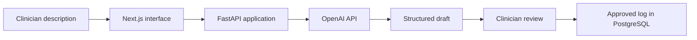

# Ikechukwu Chukwudi
### Cardiology doctor in the NHS · I build tools for clinicians
**MBBS (Ibadan), MRCP(UK) | North West of England**

[View the full page](https://about.realikechukwu.com/) · [LinkedIn](https://www.linkedin.com/in/ikechukwu-chukwudi/)

Hello. I'm Ike, a cardiology doctor in the North West of England, where I live with my family of three—my wife and our toddler, who are my world.

Around clinical work, I care about cardiovascular research, practical AI in medicine, and helping people navigate big transitions. That turns into building software that helps clinicians log their training, keep up with the evidence and make sense of AI, and writing for doctors following the path I took, from medical school in Ibadan to the NHS.

## Projects

| Project | What it is | Reach (Oct 2026) | Links |
|---|---|---|---|
| **Clinote** | AI-assisted logbook for clinicians. Next.js, FastAPI, PostgreSQL, OpenAI API | **80 users** | [Demo](https://about.realikechukwu.com/assets/clinote-demo.mp4) · [How it works](case-studies/clinote.md) · [clinote.co](https://clinote.co/) |
| **Cardiology Digest** | Weekly email of new cardiology papers, found and summarised automatically | **70 subscribers** | [Landing page](https://digest.realikechukwu.com/) · [Sample issue](https://digest.realikechukwu.com/sample) · [How it works](case-studies/cardiology-digest.md) |

Both codebases are private, so I've written up how each one works instead.

Also:

- **[MedPally](https://app.medpally.com/)**: a personal feed of new papers for your specialty and journals, each with a short summary. Cardiology is the main focus, with general practice and spine surgery added at the request of colleagues.
- **[MedPally Find](https://find.medpally.com/)**: a free, hand-curated directory of about 50 cardiology and cardiac critical care resources, mostly educational tools built by clinicians. [Open source](https://github.com/realikechukwu/medpally-find).
- **[AI in Cardiology Decoded](https://aicardio.medpally.com/)**: a free, plain-language guide to machine learning for clinicians, written as a study companion to the 2026 ESC scientific statement on AI in cardiology.

## Clinote

You describe a procedure or case in your own words, Clinote turns it into a structured log entry, and you check it before saving.

**[Watch the demo](https://about.realikechukwu.com/assets/clinote-demo.mp4)**

I built it end to end with **Next.js, FastAPI and PostgreSQL**, using the OpenAI API for the extraction step, and went through a lot of prompt iterations to get the output structure consistent.

It's for anonymised training logs only, and users are told not to enter patient identifiers.

[How Clinote works](case-studies/clinote.md)

## Cardiology Digest

A weekly email that pulls new cardiology papers from PubMed, filters them, and summarises each abstract. It has **70 subscribers**.

[How the digest works](case-studies/cardiology-digest.md) · [Landing page](https://digest.realikechukwu.com/) · [Sample issue](https://digest.realikechukwu.com/sample)

## Background

- **Cardiology registrar**, North Cheshire and Mersey NHS Foundation Trust.
- **Previously NIHR ACF in Internal Medicine/Cardiology**, University of Liverpool, working on cardiovascular outcomes and inequalities using real-world NHS data.
- **Research:** evidence synthesis and critical appraisal, with data analysis in Python and R.
- **Qualifications:** MBBS (Ibadan), MRCP(UK).

## Get in touch

The best way to reach me is a message on LinkedIn. I'm happy to talk about advances in AI and how we can make them benefit everyone, including ways to improve access for people who are less advantaged, or anything else on my page. I'm based in Liverpool with my family.

[LinkedIn](https://www.linkedin.com/in/ikechukwu-chukwudi/) · [ORCID](https://orcid.org/0000-0002-0646-5031) · [GitHub](https://github.com/realikechukwu)
